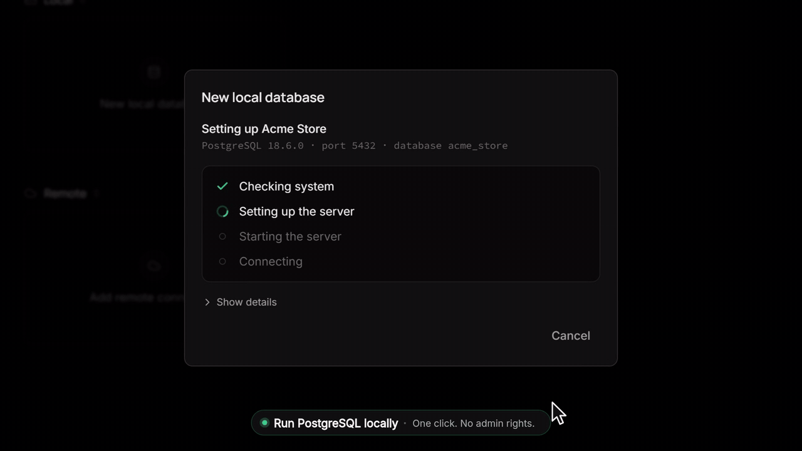
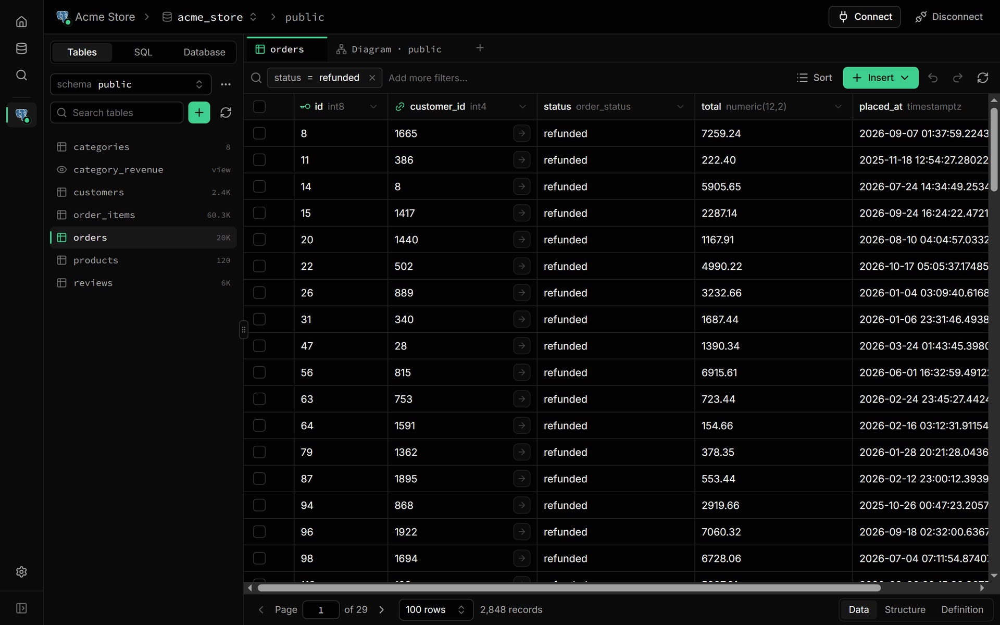
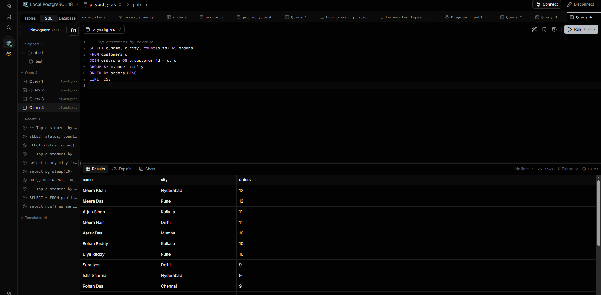
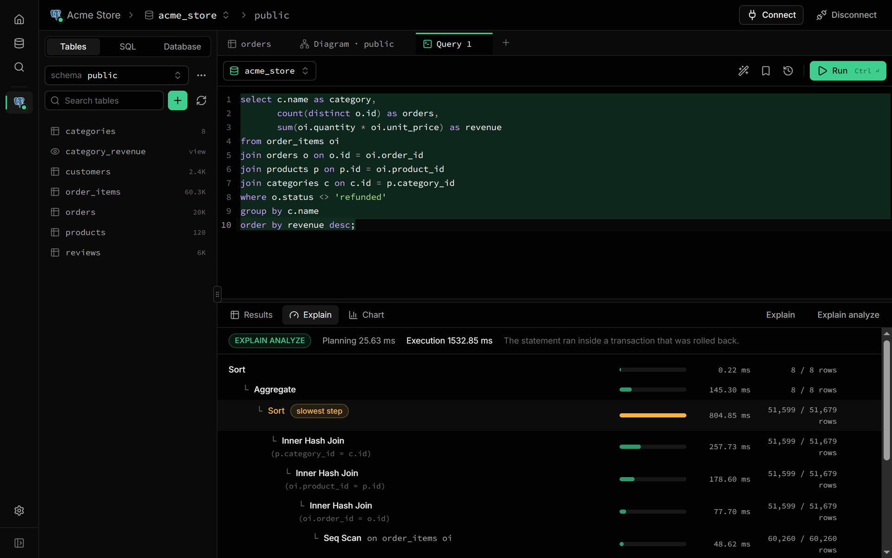
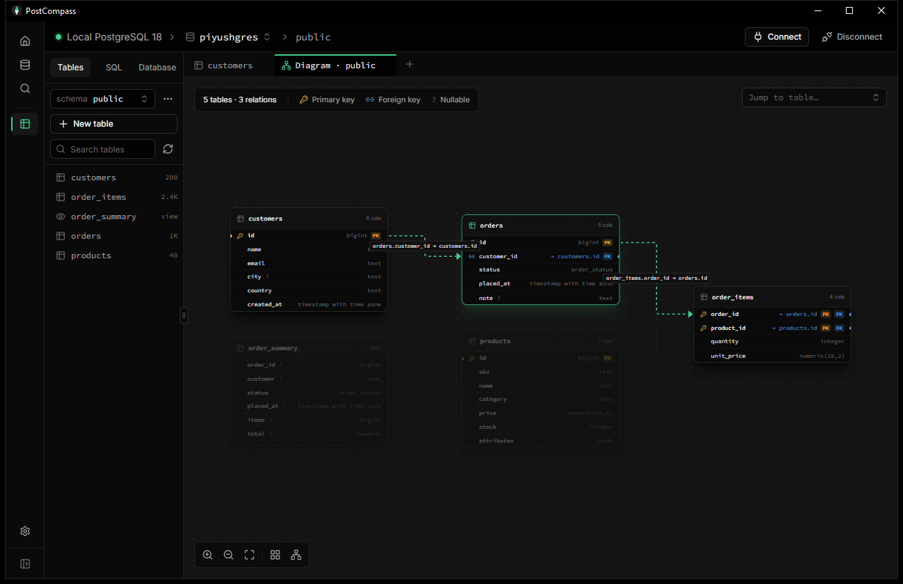

<div align="center">


<h1>PostCompass</h1>

<p><strong>A fast, modern desktop app for PostgreSQL.</strong><br />
Run a local database in one click, connect to any cloud, and browse, edit and query your data in one place.</p>

<p>
  <a href="https://github.com/piyushg-07/postcompass/releases/latest"></a>
  
  <a href="LICENSE"></a>
</p>

<a href="docs/assets/demo.mp4"></a>

</div>

## Why PostCompass

- **Zero setup.** No PostgreSQL on your machine? PostCompass downloads, verifies and runs one for you. No admin rights, no Docker.
- **Local and cloud together.** Your local servers and cloud databases live side by side.
- **Small and fast.** Built with Rust and Tauri; the Windows installer is about 3 MB.
- **Private.** Passwords stay in your system keychain, local servers listen only on `127.0.0.1`, and there's no telemetry.

## Features

- **PostgreSQL in one click:** install versions 14 to 18, start and stop servers, back up and restore.
- **Every cloud:** AWS RDS / Aurora, Google Cloud SQL, Azure, Alibaba Cloud, Oracle Cloud, DigitalOcean, Heroku Postgres, Neon, Railway, Render, Cloudflare Hyperdrive, or any PostgreSQL server.
- **Table editor:** inline edits that save instantly, filters, sorting, CSV import and export, and foreign-key navigation.
- **SQL editor:** autocomplete for your schema, query history, saved queries and charts.
- **Visual EXPLAIN:** see your query plan as a tree, with the slowest step highlighted.
- **ER diagram:** your tables and relationships, draggable and interactive.
- **Schema tools:** tables, indexes, constraints, triggers, functions, enums, extensions and Row Level Security.
- **Command palette:** press `Ctrl+K` to jump to any table, query or action.

<table>
  <tr>
    <td></td>
    <td></td>
  </tr>
  <tr>
    <td></td>
    <td></td>
  </tr>
</table>

## Download

The quickest way is one command, which installs the latest version with no security prompts:

```bash
# macOS and Linux (Terminal)
curl -fsSL https://www.postcompass.cloud/install.sh | sh
```

```powershell
# Windows (PowerShell)
irm https://www.postcompass.cloud/install.ps1 | iex
```

Or get an installer from the **[Releases page](https://github.com/piyushg-07/postcompass/releases/latest)**.

| Platform | File |
| --- | --- |
| Windows 10 / 11 | `PostCompass_x.y.z_x64-setup.exe`, or the `.msi` |
| macOS (Apple Silicon) | `PostCompass_x.y.z_aarch64.dmg` |
| macOS (Intel) | `PostCompass_x.y.z_x64.dmg` |
| Linux | `.AppImage`, `.deb` or `.rpm` |

<details>
<summary><b>First launch: the installers aren't code-signed yet</b></summary>

- **Windows:** on the SmartScreen prompt, click **More info → Run anyway**.
- **macOS:** open the app, then go to **System Settings → Privacy & Security** and click **Open Anyway**. If macOS says the app "is damaged", run `xattr -cr /Applications/PostCompass.app`.
- **Linux AppImage:** `chmod +x PostCompass_*.AppImage && ./PostCompass_*.AppImage` (on Ubuntu 22.04+ you may need `sudo apt install libfuse2`).
- **Debian / Ubuntu:** `sudo apt install ./PostCompass_*_amd64.deb`
- **Fedora / RHEL:** `sudo dnf install ./PostCompass-*.x86_64.rpm`

</details>

## Contributing

Contributions of every size are welcome, from a typo fix to a new feature.

### Ways to help

- **Report a bug:** [open a bug report](https://github.com/piyushg-07/postcompass/issues/new?template=bug_report.yml) with your OS, PostCompass version and steps to reproduce.
- **Suggest a feature:** [open a feature request](https://github.com/piyushg-07/postcompass/issues/new?template=feature_request.yml) or start a thread in [Discussions](https://github.com/piyushg-07/postcompass/discussions).
- **Improve the docs:** fixes to this README, [CONTRIBUTING.md](CONTRIBUTING.md) or code comments are always appreciated.
- **Send a pull request:** pick an open issue, or discuss bigger changes in an issue first.

### Set up the project

You need **Node.js 24+**, **pnpm** (run `corepack enable` once), **Rust stable** and the [Tauri 2 prerequisites](https://tauri.app/start/prerequisites/) for your OS.

```bash
git clone https://github.com/piyushg-07/postcompass.git
cd postcompass
corepack enable
pnpm install
pnpm dev:desktop   # starts the app with hot reload
```

The first run compiles the Rust backend and takes a few minutes; later runs are fast.

### Pull request workflow

1. Fork the repository and create a branch from `main`, e.g. `fix/grid-null-paste` or `feat/roles-ui`.
2. Keep each pull request focused on one change.
3. Make sure the checks pass:

   ```bash
   pnpm check-types && pnpm lint && pnpm rust:check && pnpm rust:test
   ```

4. Use [Conventional Commits](https://www.conventionalcommits.org/) for messages, e.g. `fix: keep column order after refresh`.
5. Open the pull request against `main`, fill in the template and add screenshots for UI changes.

The full guide, including architecture, project structure and the release process, is in **[CONTRIBUTING.md](CONTRIBUTING.md)**. Please follow the [Code of Conduct](CODE_OF_CONDUCT.md), and report security issues privately as described in [SECURITY.md](SECURITY.md), never in a public issue.

## License

PostCompass is free and open source under the **[MIT License](LICENSE)**. You can use, modify and share it, including commercially, as long as you keep the copyright notice. It's provided as is, without warranty.

Copyright © 2026 Piyush Gupta.

## Reach out

Questions, feedback or just want to say hi? Get in touch:

| | GitHub | Email |
| --- | --- | --- |
| **Piyush Gupta** (maintainer) | [@piyushg-07](https://github.com/piyushg-07) | [guptapiyush315@gmail.com](mailto:guptapiyush315@gmail.com) |
| **Also reachable at** | [@hackhub817](https://github.com/hackhub817) | [piyushguptaji123@gmail.com](mailto:piyushguptaji123@gmail.com) |

For bugs and feature ideas, please use [GitHub Issues](https://github.com/piyushg-07/postcompass/issues) so others can follow along. For security issues, follow [SECURITY.md](SECURITY.md).

---

<div align="center">
  <sub>Made with 💚 by <a href="https://github.com/piyushg-07">Piyush Gupta</a> for everyone who loves PostgreSQL.<br />If PostCompass makes your day a little easier, a ⭐ on GitHub means a lot.</sub>
</div>
