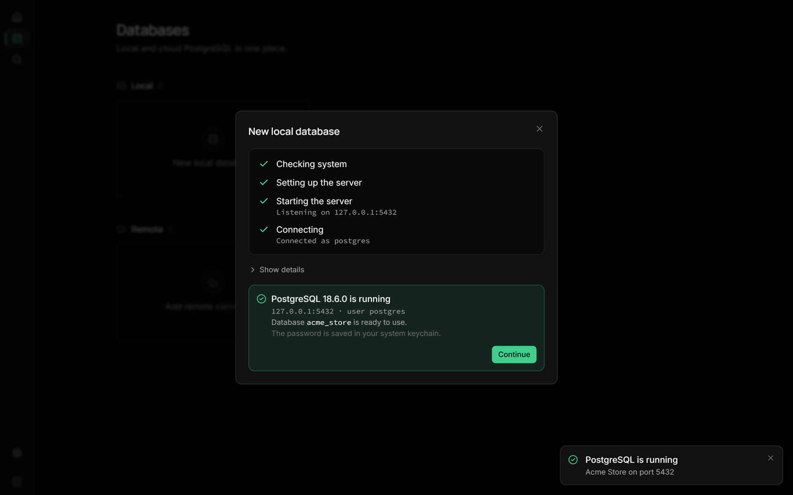
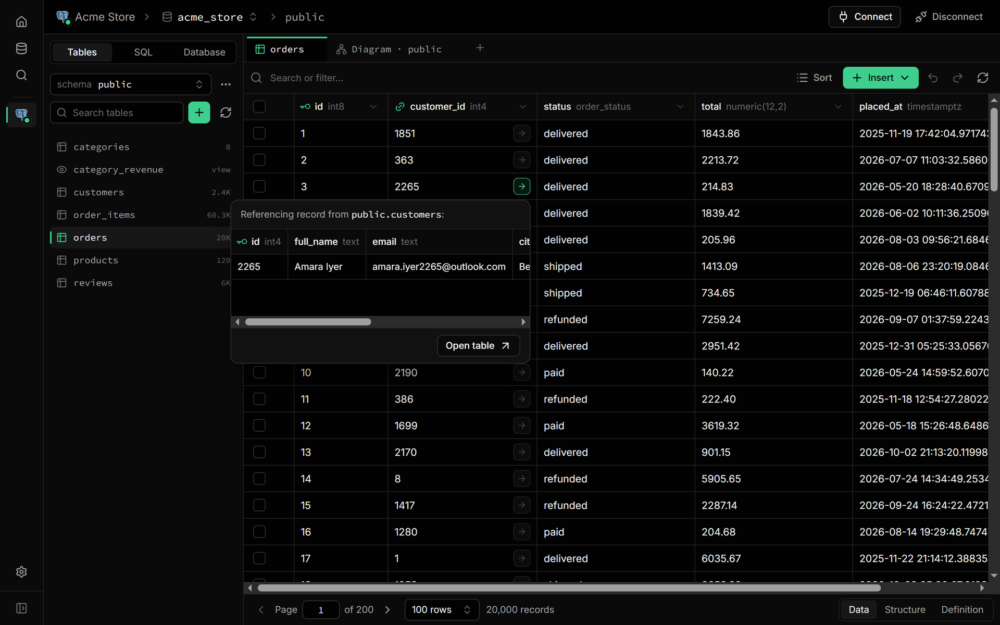
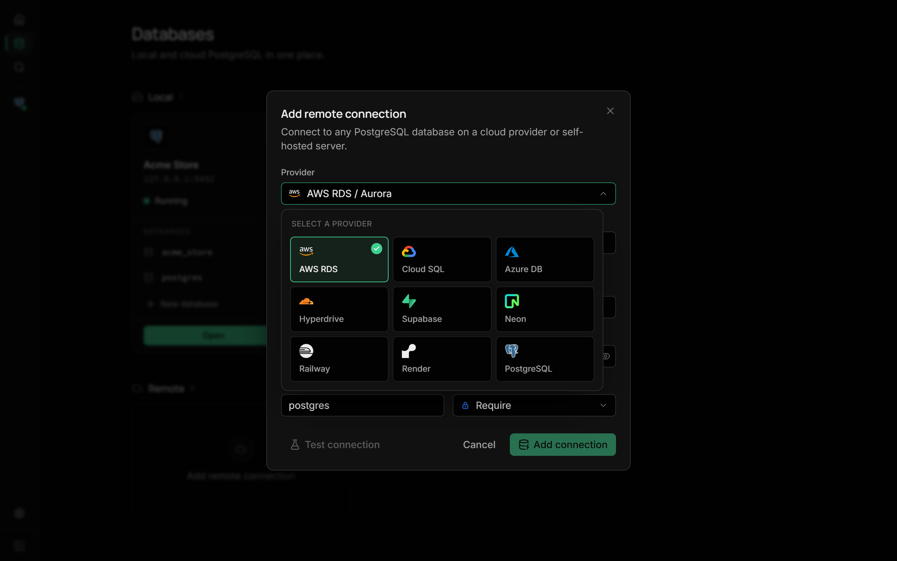
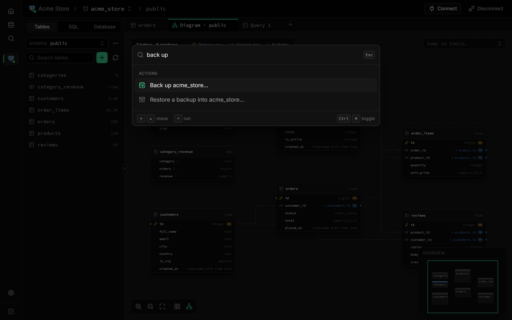

<div align="center">


<h1>PostCompass</h1>

<p><strong>A fast, modern desktop app for PostgreSQL.</strong><br />
Spin up a local database in one click, connect to any cloud, and browse, edit and query your data in one beautiful app.</p>

<p>
  <a href="https://github.com/piyushg-07/postcompass/releases/latest"></a>
  <a href="https://github.com/piyushg-07/postcompass/releases"></a>
  
  <a href="LICENSE"></a>
  
</p>

<p>
  <a href="#-download"><strong>Download</strong></a> ·
  <a href="#-features"><strong>Features</strong></a> ·
  <a href="#-faq"><strong>FAQ</strong></a> ·
  <a href="CONTRIBUTING.md"><strong>Contributing</strong></a> ·
  <a href="https://github.com/piyushg-07/postcompass/discussions"><strong>Discussions</strong></a>
</p>

<a href="docs/assets/demo.mp4"></a>

<sub>▶ <a href="docs/assets/demo.mp4"><b>Watch the full 2-minute tour</b></a></sub>

</div>

---

## Why PostCompass?

Most PostgreSQL tools are either powerful but dated, or beautiful but web-only. PostCompass brings a Supabase-quality experience to a native desktop app:

- **Zero setup.** No PostgreSQL on your machine? PostCompass downloads, verifies and runs one for you, with **no admin rights** and no Docker.
- **Local and cloud, side by side.** Your local servers and your AWS RDS, Supabase, Neon or Cloud SQL connections live in one place.
- **Fast and tiny.** Built with Rust and Tauri, the Windows installer is about **3 MB**, not a 300 MB Electron bundle.
- **Private by default.** Passwords live in your system keychain, local servers only listen on `127.0.0.1`, and there's no telemetry.

### At a glance

| | |
|---|---|
| **Platforms** | Windows 10/11 · macOS (Apple Silicon and Intel) · Linux (AppImage, `.deb`, `.rpm`) |
| **Installer size** | ~3.3 MB (`setup.exe`) · ~4.2 MB (`.dmg`) · ~4.8 MB (`.deb`) |
| **Local PostgreSQL** | 14, 15, 16, 17 and 18, installed per user with checksum-verified binaries |
| **Cloud** | AWS RDS / Aurora, Google Cloud SQL, Azure, Supabase, Neon, Cloudflare Hyperdrive, Railway, Render, or any PostgreSQL |
| **Passwords** | Windows Credential Manager · macOS Keychain · Linux Secret Service |
| **License** | [MIT](LICENSE), free forever |

## ✨ Features

<table>
<tr>
<td width="55%"></td>
<td width="45%">

### 🗄️ PostgreSQL in one click

Pick a version, name it, done. PostCompass downloads the official binaries, verifies the checksum, initialises the cluster and starts it, with live progress at every step.

- PostgreSQL **14 to 18**, side by side
- Start, stop and remove servers; detects existing installs
- Passwords generated for you and kept in your keychain
- **Backup and restore** with bundled `pg_dump` / `pg_restore`

</td>
</tr>
<tr>
<td width="45%">

### 📋 A table editor you already know

A Supabase-style grid where edits save instantly, with undo.

- Filter pills (`status = refunded`) with value suggestions for enums
- Multi-column sort, pagination, frozen and hidden columns
- Insert rows in a side panel, paste rows straight from Excel, or import CSV
- Copy or export selections as CSV, JSON or SQL

</td>
<td width="55%"></td>
</tr>
<tr>
<td width="55%"></td>
<td width="45%">

### 🔗 Follow your foreign keys

Click the arrow in any foreign-key cell to peek at the linked record, then jump to its table in one click. Column headers show stats too: distinct values, NULLs and the most common values.

</td>
</tr>
<tr>
<td width="45%">

### ⚡ A SQL editor that knows your schema

- Autocomplete for your tables and columns
- `Ctrl+Enter` runs the statement under the cursor, `Ctrl+Shift+Enter` runs everything
- Warns before `DROP`, `TRUNCATE` or an `UPDATE` without `WHERE`
- Query history, saved queries, snippets and templates
- Export results as CSV, JSON, Markdown or `INSERT` statements

</td>
<td width="55%"></td>
</tr>
<tr>
<td width="55%"></td>
<td width="45%">

### 🔍 Visual EXPLAIN ANALYZE

See your query plan as a tree with timing bars. The **slowest step** is flagged, and estimate-vs-actual row mismatches are highlighted. `EXPLAIN ANALYZE` runs inside a transaction that's rolled back, so it's safe on writes. Then chart any result as a bar or line chart.

</td>
</tr>
<tr>
<td width="45%">

### 🧭 An ER diagram that's actually useful

- Column-to-column relationship lines
- Hover a table to light up everything it's connected to
- Drag tables around (positions are remembered), auto-arrange, minimap
- Double-click a table to open it

</td>
<td width="55%"></td>
</tr>
<tr>
<td width="55%"></td>
<td width="45%">

### ☁️ Every cloud, one place

Pick your provider and PostCompass fills in sensible defaults. Choose an encryption mode (Off, Prefer, Require or **Verify certificate** with your provider's CA bundle), and **test the connection** before you save it.

</td>
</tr>
<tr>
<td width="45%">

### ⌨️ Everything is one keystroke away

Press `Ctrl+K` to jump to any table, view, function or saved query, switch databases, or run an action like *Back up*, *New table* or *ER diagram*.

The **Connect** panel gives you connection strings (URI, psql, `.env`, JDBC) and ready-made snippets for Node.js, Python, Prisma, Drizzle and Go.

</td>
<td width="55%"></td>
</tr>
</table>

<details>
<summary><b>And a lot more…</b></summary>

- **Schema tools.** Create and edit tables visually (types, defaults, primary keys, identity, arrays, foreign keys) and preview the SQL before you save.
- **Indexes, constraints and triggers.** B-tree, Hash, GIN, GiST and BRIN indexes with a live SQL preview.
- **Row Level Security.** Enable RLS and write policies from templates, with `USING` / `WITH CHECK` editors.
- **Database objects.** Functions, triggers, enums, sequences and extensions (pgvector, PostGIS…) with install, update and remove.
- **Keyboard first.** `Ctrl+T` new query, `Ctrl+W` close tab, `Ctrl+Tab` to cycle, `Ctrl+B` sidebar, and spreadsheet-style keys in the grid.

</details>

## 📦 Download

Grab the latest installer from the **[Releases page](https://github.com/piyushg-07/postcompass/releases/latest)**:

| Platform | File |
|---|---|
| **Windows** 10 / 11 | `PostCompass_x.y.z_x64-setup.exe` (recommended), or the `.msi` for managed installs |
| **macOS** Apple Silicon | `PostCompass_x.y.z_aarch64.dmg` |
| **macOS** Intel | `PostCompass_x.y.z_x64.dmg` |
| **Linux** | `.AppImage` (any distro), `.deb` (Ubuntu / Debian) or `.rpm` (Fedora) |

> [!NOTE]
> Installers aren't code-signed yet, so your system warns you the first time:
>
> - **Windows:** the installer shows *Unknown publisher*. On the SmartScreen prompt, click **More info → Run anyway**.
> - **macOS:** drag PostCompass to Applications and open it. When macOS says it can't verify the app, open **System Settings → Privacy & Security**, scroll down and click **Open Anyway**.
> - **macOS, if it says the app "is damaged":** run `xattr -cr /Applications/PostCompass.app` in Terminal, then open it again.

**First run:** answer two quick questions, then click **New local database** (or **Add remote connection** if your database is in the cloud). Open it and press `Ctrl+K` anytime to jump anywhere.

## ❓ FAQ

<details>
<summary><b>Is it really free?</b></summary>

Yes. PostCompass is open source under the MIT license, with no paid tier, no account and no sign-up.
</details>

<details>
<summary><b>Do I need to install PostgreSQL or Docker first?</b></summary>

No. **New local database** downloads the official PostgreSQL binaries for your platform, verifies their SHA-256 checksum and runs the server as your user, with no admin rights needed. If you already have PostgreSQL, PostCompass can connect to it like any other server.
</details>

<details>
<summary><b>Where are my passwords stored?</b></summary>

In your operating system's keychain: Windows Credential Manager, macOS Keychain or the Linux Secret Service. They're never written to PostCompass's own files.
</details>

<details>
<summary><b>Does PostCompass collect any data?</b></summary>

No. The app talks only to your own databases. The one request it makes by itself is downloading PostgreSQL binaries when you create a local server.
</details>

<details>
<summary><b>Can other machines reach the local servers it creates?</b></summary>

No. Servers created by PostCompass listen only on `127.0.0.1` and use `scram-sha-256` authentication.
</details>

<details>
<summary><b>Will it support MySQL or SQLite?</b></summary>

The backend is built around a driver interface, so more engines can be added. PostgreSQL comes first; see the roadmap below.
</details>

## 🗺️ Roadmap

- [x] One-click local PostgreSQL install, start / stop, detection
- [x] Table editor with filters, sort, inline edits and foreign-key navigation
- [x] SQL editor with visual EXPLAIN and charts
- [x] ER diagram, command palette, backup and restore
- [x] Cloud connections (RDS, Supabase, Neon, Cloud SQL, Azure…)
- [ ] Auto-updates
- [ ] Code-signed installers
- [ ] Monitoring (active queries, locks, slow queries)
- [ ] Roles and permissions UI
- [ ] More engines (MySQL, SQLite…)

Have an idea? [Start a discussion](https://github.com/piyushg-07/postcompass/discussions) or [open a feature request](https://github.com/piyushg-07/postcompass/issues/new?template=feature_request.yml).

## 🤝 Contributing

Contributions are welcome, from bug reports to pull requests. **[CONTRIBUTING.md](CONTRIBUTING.md)** covers setup, architecture, the project layout and how releases work. In short:

```bash
git clone https://github.com/piyushg-07/postcompass.git
cd postcompass
pnpm install
pnpm dev        # runs the desktop app with hot reload
```

Please read the [Code of Conduct](CODE_OF_CONDUCT.md), and report security issues privately as described in [SECURITY.md](SECURITY.md).

<a href="https://github.com/piyushg-07/postcompass/graphs/contributors">
  
</a>

## 💚 Built with

[Tauri](https://tauri.app) · [Rust](https://www.rust-lang.org) · [React](https://react.dev) · [tokio-postgres](https://github.com/sfackler/rust-postgres) · [CodeMirror](https://codemirror.net) · [TanStack](https://tanstack.com) · [React Flow](https://reactflow.dev) · PostgreSQL binaries from [theseus-rs](https://github.com/theseus-rs/postgresql-binaries). The design is inspired by [Supabase Studio](https://supabase.com).

## 📄 License

PostCompass is open source under the [MIT License](LICENSE).

Copyright © 2026 Piyush Gupta.

<div align="center">
<sub>If PostCompass saves you time, a ⭐ helps other developers find it.</sub>
</div>
