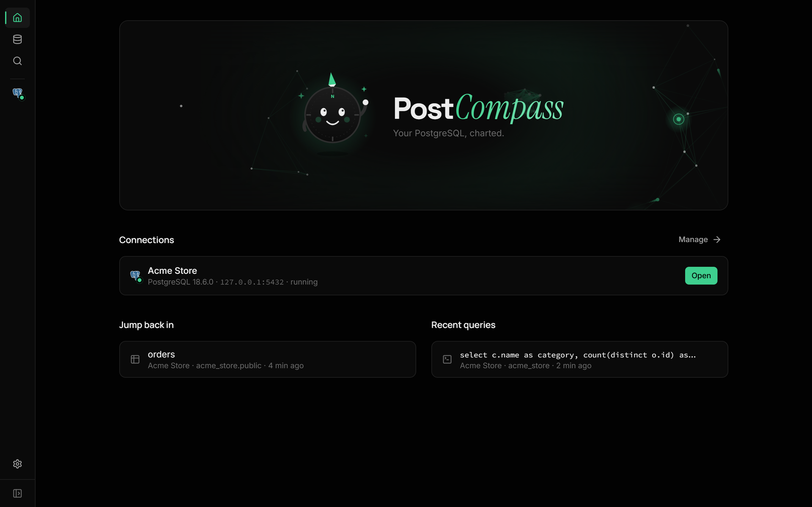

<div align="center">


<h1>PostCompass</h1>

<p><strong>A fast, modern desktop app for PostgreSQL.</strong><br />
Run local databases in one click, connect to the cloud, and browse, edit and query your data, all in one beautiful app.</p>

<p>
  <a href="https://github.com/piyushg-07/postcompass/releases/latest"></a>
  
  
  
  
  <a href="LICENSE"></a>
</p>

<p>
  <a href="#-download"><strong>Download</strong></a> ·
  <a href="#-features"><strong>Features</strong></a> ·
  <a href="#-screenshots"><strong>Screenshots</strong></a> ·
  <a href="#-development"><strong>Development</strong></a> ·
  <a href="#-roadmap"><strong>Roadmap</strong></a>
</p>


<sub>Prefer video? <a href="docs/assets/demo.mp4">Watch the demo (MP4)</a>.</sub>

</div>

---

## Why PostCompass?

Most PostgreSQL tools are either powerful but dated (pgAdmin) or beautiful but web-only (Supabase Studio). PostCompass brings a Supabase-quality experience to your desktop:

- **Zero setup.** No PostgreSQL on your machine? PostCompass installs and runs one for you, privately, with **no admin rights**.
- **Local and cloud, side by side.** Your local databases and your AWS RDS, Supabase, Neon or Google Cloud SQL connections live in one place.
- **Fast and light.** A native app built with Rust and Tauri: a small installer and low memory use, not a 300 MB Electron bundle.
- **Safe by default.** Passwords live in your system keychain, local servers only listen on `127.0.0.1`, and destructive actions always ask first.

## ✨ Features

<table>
<tr>
<td width="50%" valign="top">

### 🗄️ Local databases
- One-click install of **PostgreSQL 18** (checksum-verified binaries)
- Start, stop and remove servers; detects existing installs
- Create, rename and drop databases and schemas
- **Backup and restore** with bundled `pg_dump` / `pg_restore`

### ☁️ Cloud connections
- AWS RDS / Aurora, Google Cloud SQL, Azure, Supabase, Neon, Cloudflare Hyperdrive, Railway, Render, or any PostgreSQL
- Encryption modes: Off, Prefer, Require, **Verify certificate** (with your provider's CA bundle)
- Test before you save; passwords stored in the OS keychain

### 📋 Table editor
- Supabase-style grid with **inline editing that saves instantly**
- Filter bar (`city = Delhi`, `price >= 100` …), multi-column sort, pagination
- Insert and edit rows in a side panel; **follow foreign keys** to the linked record
- Select rows to copy or export as CSV, JSON or SQL

</td>
<td width="50%" valign="top">

### 🧱 Schema tools
- Create tables and columns visually (types, defaults, PK, unique, identity, RLS)
- Indexes, foreign keys, constraints and triggers
- Functions, triggers, enums, sequences and **extensions** (pgvector, PostGIS…)

### ⚡ SQL editor
- CodeMirror editor with autocomplete for your tables and columns
- Run all or just the selection (`Ctrl+Enter`), multiple result sets
- **Visual EXPLAIN / EXPLAIN ANALYZE** that highlights the slowest step
- Query history and saved queries

### 🧭 Everything else
- Interactive **ER diagram**: draggable tables, column-to-column links, focus mode, minimap
- **Command palette** (`Ctrl+K`) to jump to any table, database or action
- Connect dialog with connection strings and snippets for Node.js, Python, Prisma, Drizzle and Go
- Dark UI with a Supabase-inspired design

</td>
</tr>
</table>

## 📸 Screenshots

<table>
<tr>
<td width="50%"><p align="center"><sub><b>Table editor</b>: edit inline, filter, sort, follow foreign keys</sub></p></td>
<td width="50%"><p align="center"><sub><b>ER diagram</b>: column-level relationships with focus mode</sub></p></td>
</tr>
<tr>
<td width="50%"><p align="center"><sub><b>SQL editor</b>: autocomplete, results, history</sub></p></td>
<td width="50%"><p align="center"><sub><b>Visual EXPLAIN ANALYZE</b>: find the slowest step at a glance</sub></p></td>
</tr>
<tr>
<td colspan="2"><p align="center"><sub><b>Home</b>: every connection, local and cloud, plus where you left off</sub></p></td>
</tr>
</table>

## 📦 Download

Grab the latest installer from the **[Releases page](https://github.com/piyushg-07/postcompass/releases/latest)**:

| Platform | File |
|---|---|
| **Windows** 10 / 11 | `PostCompass_x.y.z_x64-setup.exe` (recommended), or the `.msi` for managed installs |
| **macOS** (Apple Silicon) | `PostCompass_x.y.z_aarch64.dmg` |
| **macOS** (Intel) | `PostCompass_x.y.z_x64.dmg` |
| **Linux** | `.AppImage` (any distro), `.deb` (Ubuntu / Debian) or `.rpm` (Fedora) |

> [!NOTE]
> Builds aren't code-signed yet. On **Windows**, choose **More info → Run anyway** when SmartScreen appears. On **macOS**, right-click the app and choose **Open** the first time.

### First run

1. Answer a couple of quick onboarding questions.
2. **No PostgreSQL yet?** Click **New local database**. PostCompass downloads, verifies and starts PostgreSQL for you.
3. **Already have one in the cloud?** Click **Add remote connection**, pick your provider and paste your details.
4. Open a database and start exploring. Press `Ctrl+K` anytime to jump anywhere.

## 🛠️ Development

### Prerequisites

| Tool | Version |
|---|---|
| [Node.js](https://nodejs.org) | 24 or newer |
| [pnpm](https://pnpm.io) | 11 (`corepack enable` picks the pinned version) |
| [Rust](https://rustup.rs) | stable (pinned in `rust-toolchain.toml`) |
| Platform tools | [Tauri prerequisites](https://tauri.app/start/prerequisites/): WebView2 + VS Build Tools on Windows, Xcode CLT on macOS, `libwebkit2gtk-4.1-dev` on Linux |

### Run it

```bash
git clone https://github.com/piyushg-07/postcompass.git
cd postcompass
pnpm install
pnpm dev            # starts the desktop app with hot reload
```

### Useful commands

| Command | What it does |
|---|---|
| `pnpm dev` | Run the desktop app in development mode |
| `pnpm build:app` | Build installers for your current OS (output in `target/release/bundle/`) |
| `pnpm check-types` | Type-check every TypeScript package |
| `pnpm lint` | Lint every package (zero warnings allowed) |
| `pnpm rust:check` | Clippy across the Rust workspace |
| `pnpm rust:test` | Run the Rust tests |

> [!TIP]
> On Windows inside a synced folder (OneDrive, Dropbox), point Cargo's `target-dir` outside the synced folder in `.cargo/config.toml`. Sync clients lock build files and break builds.

## 🏗️ Architecture

```
┌──────────────────────────────┐        typed IPC         ┌──────────────────────────────────┐
│  React 19 UI (apps/desktop)  │ ◄──── tauri-specta ────► │  Rust core (apps/desktop/src-tauri) │
│  TanStack Query/Table/Form   │   generated bindings.ts   │  commands · state · keychain      │
│  Zustand · Radix · Tailwind  │                           └───────────────┬──────────────────┘
└──────────────────────────────┘                                           │
                                         ┌─────────────────────────────────┼───────────────────────────┐
                                         ▼                                 ▼                           ▼
                                 crates/pc-core                  crates/driver-postgres        crates/runtime-postgres
                                 shared traits & types           connect · query · introspect  detect · install · start/stop
                                 (DatabaseDriver, …)             (tokio-postgres, TLS)          backup / restore
```

- **Modular by design.** Each database engine is a driver crate implementing the `DatabaseDriver` trait from `pc-core`, so more engines can be added without touching the UI.
- **End-to-end types.** Rust commands export TypeScript types automatically ([tauri-specta](https://github.com/specta-rs/tauri-specta)), so the UI can't call the backend with the wrong shape.
- **Secrets stay out of files.** Passwords go to Windows Credential Manager, macOS Keychain or Linux Secret Service, never to `state.json`.

### Project structure

```
postcompass/
├── apps/
│   ├── desktop/            # The PostCompass app (React + Tauri)
│   │   ├── src/            #   UI: features/, app/, lib/
│   │   └── src-tauri/      #   Rust: commands, state, keychain, window setup
│   ├── server/             # Small Hono API (experimental)
│   ├── web/ · docs/        # Next.js sites (placeholders)
├── crates/
│   ├── pc-core/            # Shared traits and types
│   ├── driver-postgres/    # PostgreSQL driver
│   └── runtime-postgres/   # Local PostgreSQL install / lifecycle / backups
├── packages/
│   ├── ui/                 # Shared design system (tokens + components)
│   ├── eslint-config/
│   └── typescript-config/
├── docs/                   # PLAN.md, POSTGRES_GUIDE.md, assets/
└── .github/workflows/      # release.yml
```

## 🚀 Releasing

Releases are fully automated with GitHub Actions ([`release.yml`](.github/workflows/release.yml)):

1. Bump `"version"` in `apps/desktop/src-tauri/tauri.conf.json` and commit.
2. Push to the release branch: `git push origin HEAD:release`
3. GitHub builds Windows, macOS (Apple Silicon and Intel) and Linux installers and creates a **draft release** `vX.Y.Z` with every file attached.
4. Review the draft on the Releases page and click **Publish**.

## 🗺️ Roadmap

- [x] One-click local PostgreSQL install, start/stop, detection
- [x] Table editor with filters, sort, inline edits and foreign-key navigation
- [x] SQL editor with visual EXPLAIN
- [x] ER diagram, command palette, backup and restore
- [x] Cloud connections (RDS, Supabase, Neon, Cloud SQL, Azure…)
- [ ] Auto-updates
- [ ] Code-signed installers
- [ ] Monitoring (active queries, locks, slow queries)
- [ ] Roles and permissions UI
- [ ] More engines (MySQL, SQLite…)

## 🤝 Contributing

Issues and ideas are welcome. Before opening a pull request, please make sure these pass:

```bash
pnpm check-types && pnpm lint && pnpm rust:check && pnpm rust:test
```

## 📄 License

PostCompass is open source under the [MIT License](LICENSE).

Copyright © 2026 Piyush Gupta.
